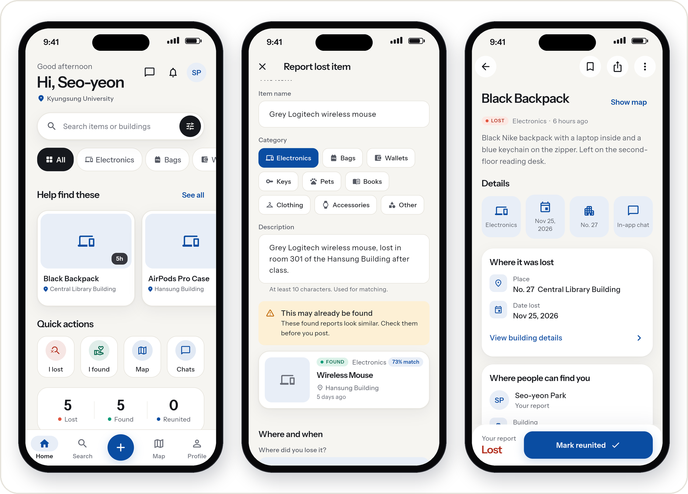
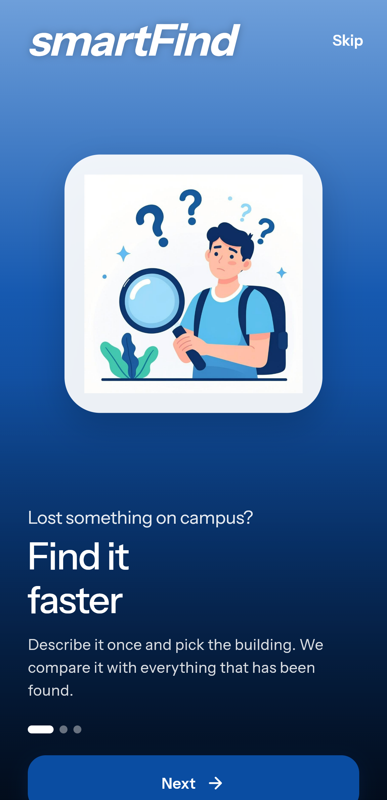
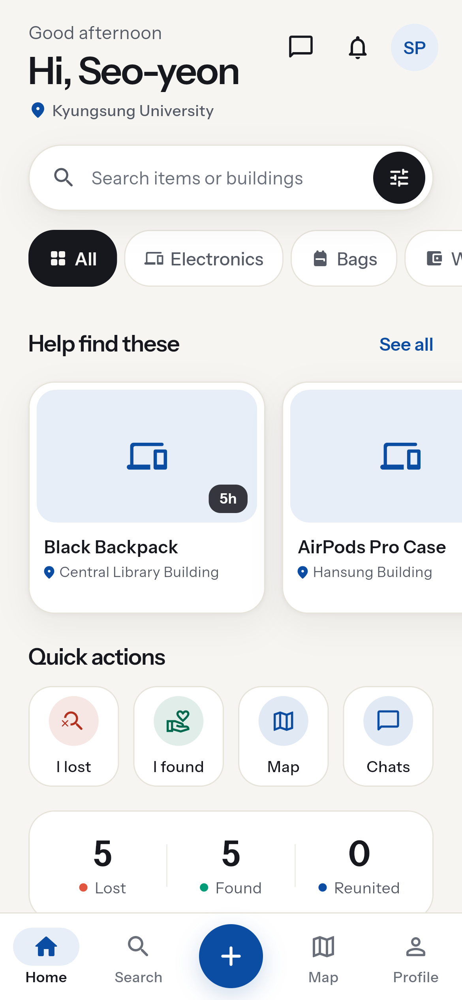
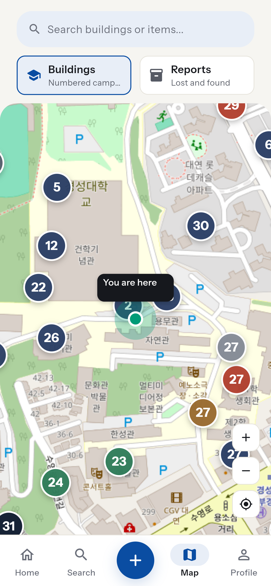
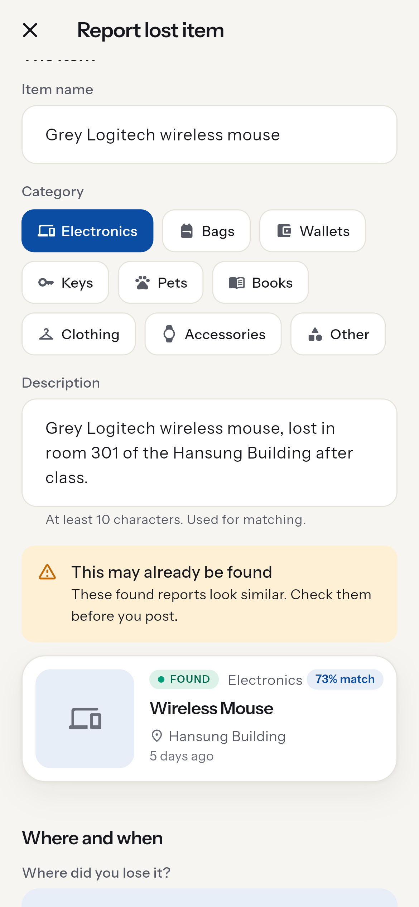
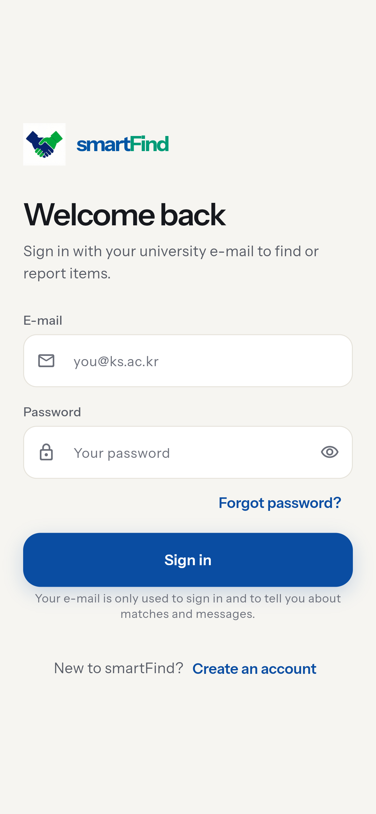
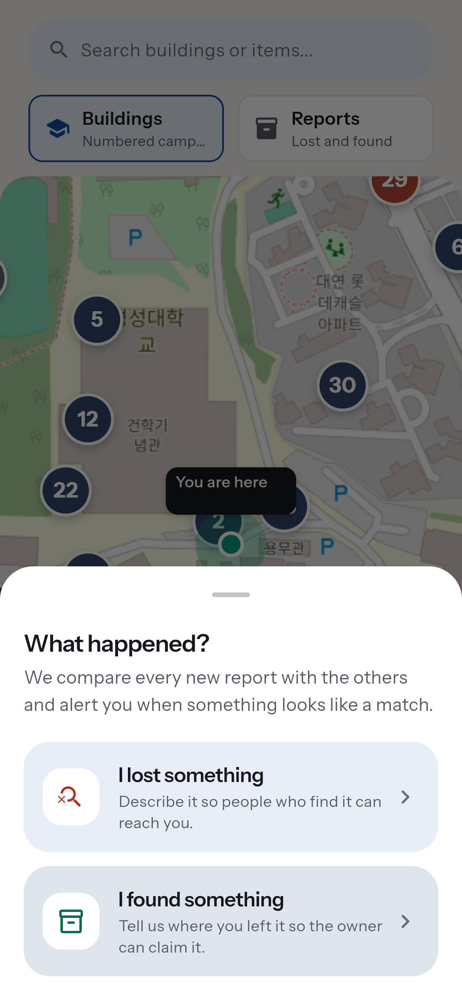
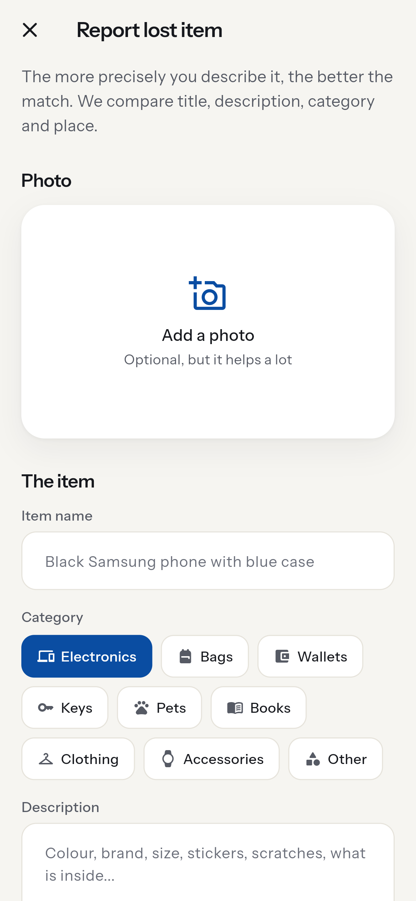
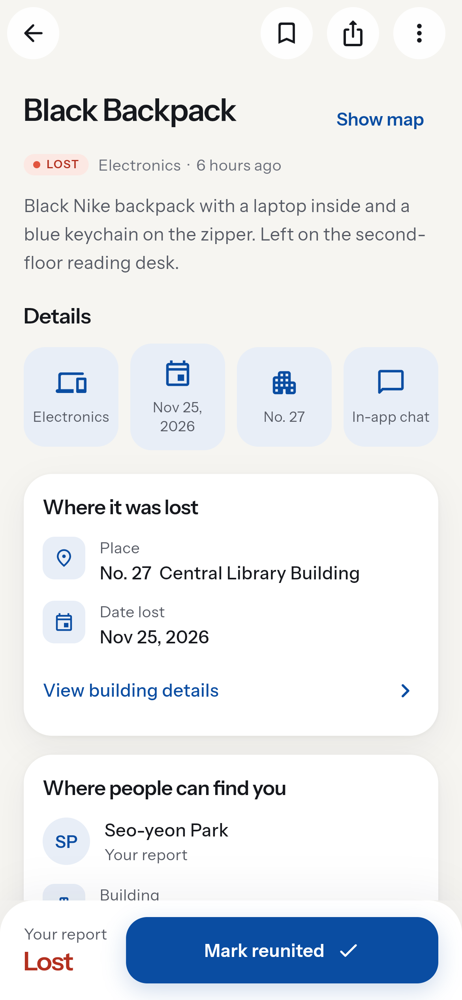

<div align="center">


### Lost items. Found faster.

A lost-and-found app for **Kyungsung University**: report what you lost or found,
get matched automatically, and chat to hand it back.




<br><br>

[](https://github.com/Dhiren1211/Capstone_01/releases/download/v1.0.0/smartFind-1.0.0.apk)
[-000000?style=for-the-badge&logo=apple&logoColor=white)](https://github.com/Dhiren1211/Capstone_01/releases/download/v1.0.0/smartFind-1.0.0-ios-unsigned.ipa)

<sub>The iOS build is unsigned; sign it with your Apple ID (e.g. <a href="https://sideloadly.io">Sideloadly</a>) to install it. · <a href="https://github.com/Dhiren1211/Capstone_01/releases">All releases</a></sub>

</div>

---

## ✨ Features

- **Report in seconds:** photo, category, building and date.
- **Smart matching:** every new report is compared with open ones; at **70 %+** similarity both people get a notification.
- **In-app chat** to arrange the hand-over, without sharing phone numbers.
- **Campus map** with numbered buildings, walking routes and the university's VR tour.
- **Admin panel:** user statistics, report verification, suspending users and correcting building positions.
- **Light & dark theme**, Android and iOS.

## 📱 Screenshots

| Onboarding | Home | Campus map | Live match |
|:---:|:---:|:---:|:---:|
|  |  |  |  |

| Sign in | Report | Report form | Item detail |
|:---:|:---:|:---:|:---:|
|  |  |  |  |

## 🚀 Quick start

**You need:** [Flutter 3.47+](https://docs.flutter.dev/get-started/install), Node.js 18+, the [Firebase CLI](https://firebase.google.com/docs/cli) and Java 17.

```bash
git clone https://github.com/Dhiren1211/Capstone_01.git
cd Capstone_01
dart run tool/setup.dart              # prepares Android/iOS settings
cp env.example.json env.json          # then fill in your Firebase + Cloudinary keys
flutter run --dart-define-from-file=env.json
```

**No Firebase project yet?** Try it locally with the emulators:

```bash
firebase emulators:start              # terminal 1
node scripts/seed-emulator.mjs        # terminal 2: demo accounts + sample reports
flutter run --dart-define-from-file=env.json   # with "USE_EMULATOR": true in env.json
```

Demo logins: `demo@ks.ac.kr / Demo1234!` · admin: `admin@ks.ac.kr / Admin1234!`

## 🛡️ Admin panel

Open **Profile → Admin panel** (visible to admins only).

1. Deploy the security rules: `firebase deploy --only firestore:rules`
2. Make the first admin: in the Firebase console → Firestore, create a collection **`admins`** with a document whose ID is your **User UID** (from Authentication).
3. Add more admins from the panel's **Users** tab.

## 📦 Build

```bash
flutter build apk --release --dart-define-from-file=env.json    # Android APK
```

**iOS** needs macOS. On Windows, use GitHub Actions: add your `env.json` as the repository secret **`ENV_JSON`**, then run **Actions → Build apps**. It produces the APK and an unsigned `.ipa`.

## 🧰 Built with

Flutter · Firebase Auth · Cloud Firestore · Firebase Cloud Messaging · Cloudinary · OpenStreetMap (`flutter_map`) · Cloudflare Workers (optional alert server)

## 📖 More

The full setup guide, troubleshooting and how matching works are in **[docs/SETUP.md](docs/SETUP.md)**.

---

<div align="center">

Made for Kyungsung University · [MIT License](LICENSE)

</div>
